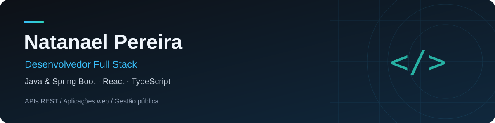

  

  
  
  

  <strong>Do banco de dados à interface: soluções para processos reais.</strong> 
  João Pessoa, PB · Desenvolvimento web · APIs REST

---

## Sobre mim

Sou desenvolvedor Full Stack com experiência profissional em sistemas para gestão pública e foco em **Java e Spring Boot**. Trabalho com React, TypeScript, Node.js, NestJS e PostgreSQL, conectando interfaces, regras de negócio e persistência de dados.

Atuei no desenvolvimento de sistemas para a **Secretaria Municipal de Educação de Bayeux** e participei da construção do **MVP do Sistema PROCON da Paraíba**. Busco oportunidades em backend Java, trazendo a visão de quem trabalha em diferentes camadas de uma aplicação.

## Stack tecnológica

**Backend & dados**

  

Spring Data JPA · Hibernate · Spring Security · OAuth2 / JWT · SQL

**Frontend**

  

Interfaces responsivas · Integração com APIs REST · Acessibilidade

**Ferramentas & entrega**

  

GitHub Actions · CI/CD · Arquitetura em camadas · Clean Code

## Projetos em destaque

<table>
  <tr>
    <td width="50%" valign="top">
      <h3><a href="https://github.com/Natanpython/Sistema-DSCommerce">DSCommerce</a></h3>
      
<strong>API de e-commerce</strong>

      
Catálogo de produtos, categorias e pedidos com autenticação JWT e controle de acesso para clientes e administradores.

      
Busca paginada, validação de dados, tratamento de erros e integração contínua com GitHub Actions.

      
<code>Java</code> <code>Spring Boot</code> <code>JPA</code> <code>Spring Security</code>

      
<a href="https://github.com/Natanpython/Sistema-DSCommerce">Explorar projeto →</a>

    </td>
    <td width="50%" valign="top">
      <h3><a href="https://github.com/Natanpython/CrudDeClients">CrudClients</a></h3>
      
<strong>API de gerenciamento de clientes</strong>

      
Cadastro e gerenciamento de clientes com operações CRUD e busca paginada.

      
Bean Validation, tratamento global de exceções e organização em camadas.

      
<code>Java</code> <code>Spring Boot</code> <code>JPA</code> <code>Hibernate</code>

      
<a href="https://github.com/Natanpython/CrudDeClients">Explorar projeto →</a>

    </td>
  </tr>
</table>

## Experiência profissional

**Secretaria Municipal de Educação de Bayeux** · Desenvolvedor Full Stack

Desenvolvimento e manutenção de sistemas de gestão educacional e agendamento institucional, com integração de APIs, modelagem de dados e interfaces responsivas.

**Avenir Tecnologia — MVP do Sistema PROCON PB** · Desenvolvedor Full Stack freelancer

Participação na construção do MVP com React, TypeScript, Node.js e NestJS, incluindo implementação de funcionalidades e integração com PostgreSQL por meio do Prisma.

## Código em perspectiva

  

Distribuição por linguagem dos repositórios públicos; não representa nível de domínio técnico.

### Minhas contribuições, versão Pac-Man

  

## Formação e próximos passos

Cursando **Análise e Desenvolvimento de Sistemas** e aprofundando conhecimentos em Java e Spring Boot, com foco em segurança de APIs, persistência de dados e arquitetura em camadas.

---

  <strong>Vamos conversar sobre desenvolvimento e oportunidades?</strong> 
  <a href="https://www.linkedin.com/in/natanaelpereira/">LinkedIn</a> ·
  <a href="mailto:natanaelpereira745@gmail.com">E-mail</a> ·
  <a href="https://natanael-pereira.netlify.app/">Portfólio</a>

