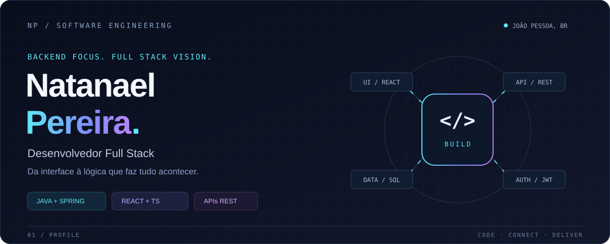
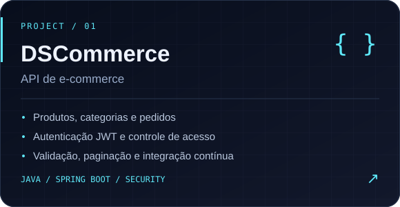
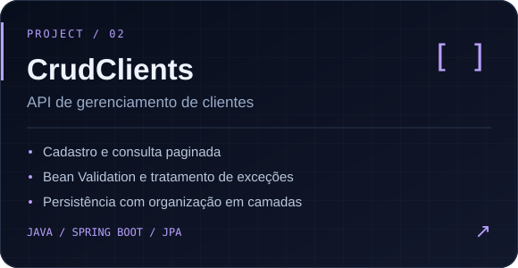

  

  
  
  

  <strong>APIs bem estruturadas. Interfaces conectadas. Software para necessidades reais.</strong>

 

## `01` &nbsp; Quem está por trás do código

Sou **Natanael Pereira**, desenvolvedor Full Stack com foco em **Java e Spring Boot**. Minha experiência conecta frontend, backend e dados em aplicações para gestão pública — da interface às regras de negócio.

Na **Secretaria Municipal de Educação de Bayeux**, desenvolvo sistemas de gestão educacional e agendamento institucional. Na **Avenir Tecnologia**, participei como freelancer da construção do **MVP do Sistema PROCON da Paraíba**, com React, TypeScript, NestJS e PostgreSQL.

> **Meu próximo passo:** atuar em backend Java, levando a visão de quem conhece o desenvolvimento de ponta a ponta.

 

## `02` &nbsp; Meu ecossistema

<table>
  <tr>
    <th width="33%" align="center">Backend &amp; dados</th>
    <th width="34%" align="center">Frontend &amp; interface</th>
    <th width="33%" align="center">Ferramentas &amp; entrega</th>
  </tr>
  <tr>
    <td align="center" valign="top">
       
      
        
      <strong>Java · Spring · Node.js</strong> 
      <strong>NestJS · PostgreSQL · Prisma</strong>
        
    </td>
    <td align="center" valign="top">
       
      
        
      <strong>React · TypeScript · JavaScript</strong> 
      <strong>HTML · CSS · Figma</strong>
        
    </td>
    <td align="center" valign="top">
       
      
        
      <strong>Git · GitHub · GitHub Actions</strong> 
      <strong>Docker · Maven · Postman</strong>
        
    </td>
  </tr>
  <tr>
    <td align="center">
      APIs REST · JPA / Hibernate Spring Security · OAuth2 / JWT
    </td>
    <td align="center">
      Interfaces responsivas · Acessibilidade Integração com APIs REST
    </td>
    <td align="center">
      Versionamento · Containers Build · CI/CD · Validação de APIs
    </td>
  </tr>
</table>

  PRINCÍPIOS &nbsp; / &nbsp; Arquitetura em camadas · Clean Code

 

## `03` &nbsp; Projetos selecionados

  
  

  <a href="https://github.com/Natanpython/Sistema-DSCommerce">Explorar DSCommerce ↗</a>
  &nbsp; · &nbsp;
  <a href="https://github.com/Natanpython/CrudDeClients">Explorar CrudClients ↗</a>
  &nbsp; · &nbsp;
  <a href="https://github.com/Natanpython?tab=repositories">Todos os repositórios ↗</a>

 

## `04` &nbsp; Código em movimento

  
   
  Linguagens por repositório público · um retrato dos projetos, não do nível de domínio.

 

<strong>CONTRIBUTIONS / PAC-MAN EDITION</strong>

  

 

## `05` &nbsp; Em constante construção

Cursando **Análise e Desenvolvimento de Sistemas** e aprofundando conhecimentos em **Java e Spring Boot**, com foco em segurança de APIs, persistência de dados e arquitetura em camadas.

---

  <strong>Vamos construir a próxima solução?</strong>  
  <a href="https://www.linkedin.com/in/natanaelpereira/">LinkedIn</a> &nbsp; / &nbsp;
  <a href="mailto:natanaeldesenvolvedorweb@gmail.com">natanaeldesenvolvedorweb@gmail.com</a> &nbsp; / &nbsp;
  <a href="https://natanaelp.netlify.app/">Portfólio</a>

NATANAEL PEREIRA &nbsp; · &nbsp; BACKEND FOCUS. FULL STACK VISION.

